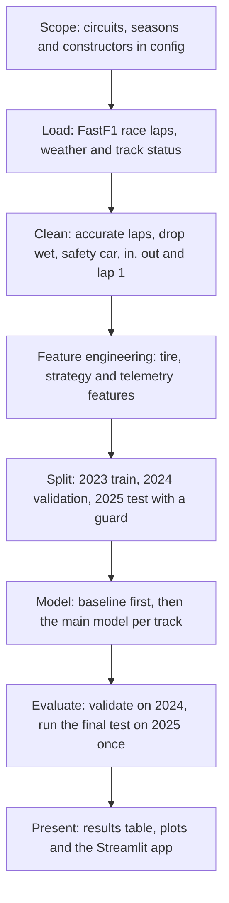

# Architecture

How data moves through the project, from config to the app.

## Data flow notes

- `src/data/loader.py` writes raw parquet snapshots into `data/`.
- `src/data/cleaning.py` turns raw laps into clean laps.
- `src/features/` builds the three feature sets from clean laps and telemetry.
- `src/data/split.py` is the only place that selects seasons.
- `src/models/`, `src/strategy/`, `src/telemetry/` and `src/evaluation/` consume features.
- `app/app.py` reads saved results, it never trains a model.

## Boundaries

- Only the main race session (type "R") is loaded. Practice, qualifying and sprints are excluded.
- Telemetry is loaded only for the speed profile track, for 3 chosen circuits, fastest laps only.
- The 2025 test set is used once, in `src/evaluation/backtest.py`.
- Constructors use stable ids from `config/constructors.yaml`.
- All plots come from Plotly or matplotlib, no other chart library.
